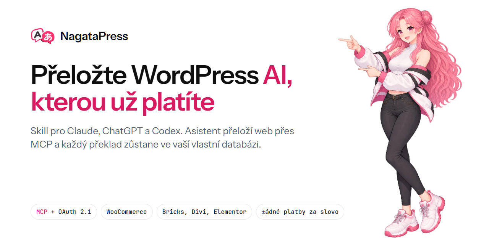
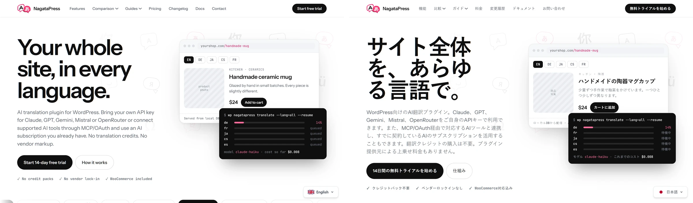
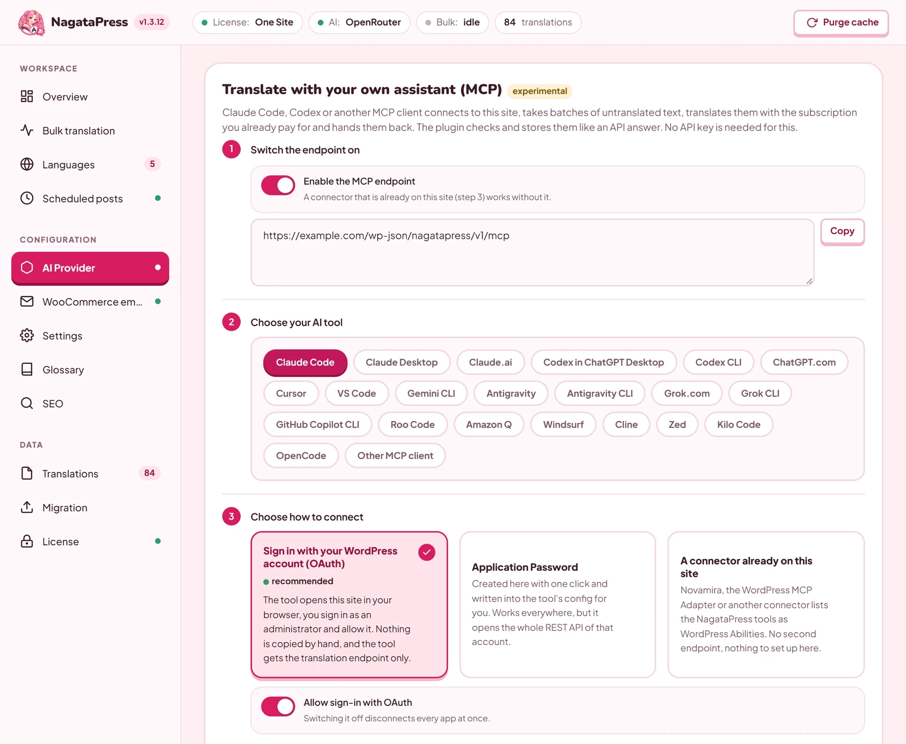
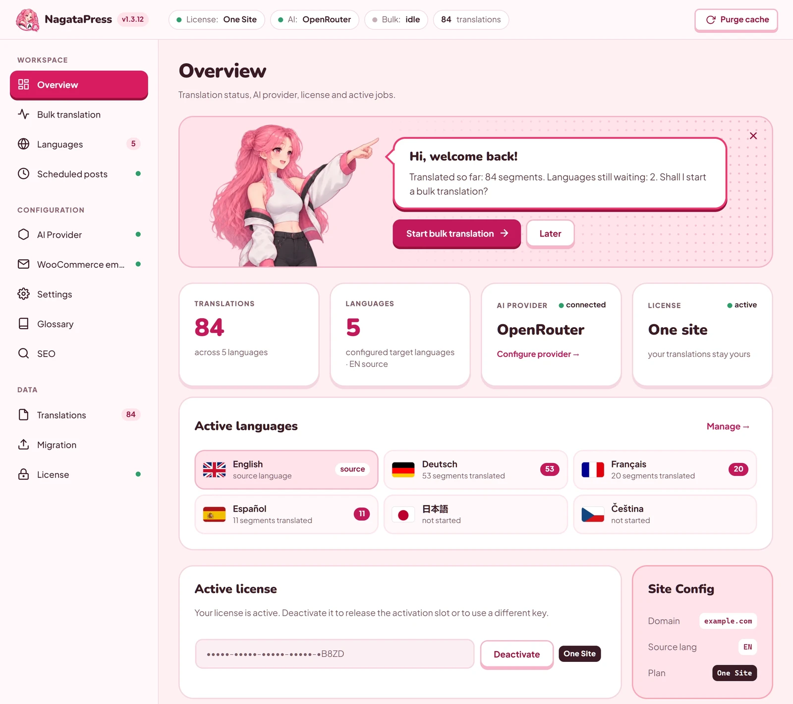
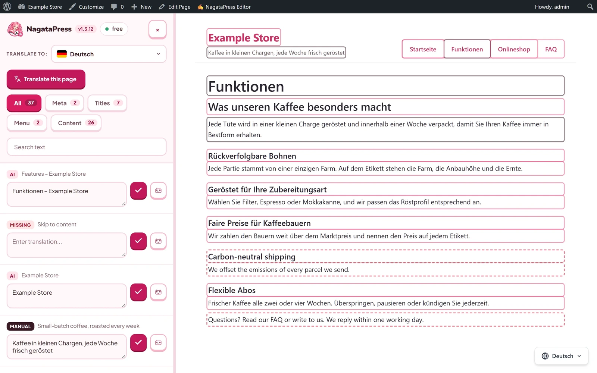
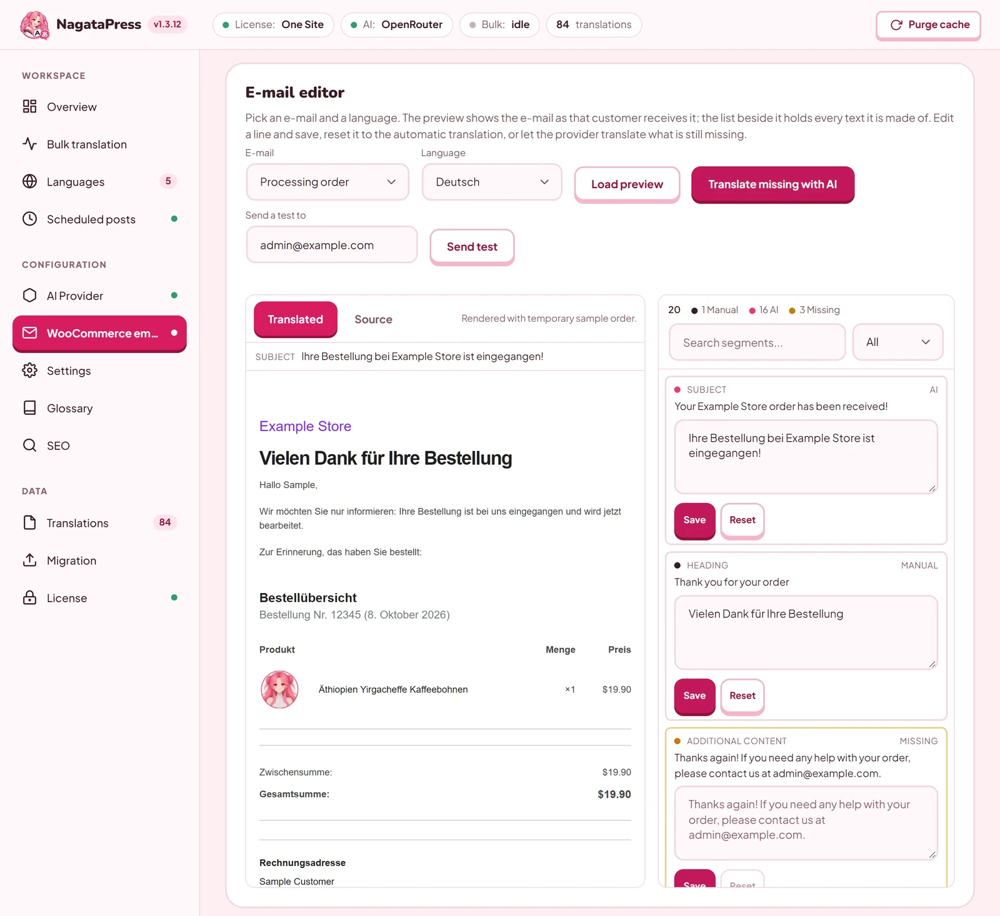

# NagataPress

[English](README.md) | **Čeština**

[](https://github.com/ffscz/NagataPress/releases/latest)
[](LICENSE)
[](https://nagatapress.com)
[](https://nagatapress.com/docs/)



[NagataPress](https://nagatapress.com) je plugin pro překlad webů na WordPressu a WooCommerce pomocí AI. Přeloží celý web: příspěvky, stránky, menu, page buildery, SEO pole a v e-shopu i košík, pokladnu a e-maily zákazníkům. Překlady se ukládají do databáze webu, takže zobrazení stránky nikdy nevolá AI. Překládat můžete dvěma způsoby:

- **Vlastním API klíčem** (Claude, OpenAI, Gemini, Mistral, OpenRouter). Plugin volá poskytovatele v překladu na pozadí.
- **Vlastním AI asistentem přes MCP.** Claude, ChatGPT/Codex, Cursor a další MCP klienti se připojí k webu (OAuth 2.1) a překládají v rámci předplatného, které už platíte. Žádné poplatky za slovo ani balíčky kreditů.

**Tento repozitář obsahuje skill NagataPress pro AI asistenty.** Samotný plugin se tu nevydává. Stahuje se z [nagatapress.com](https://nagatapress.com/#pricing) se 14denní zkušební verzí zdarma.

## Ukázka

Web nagatapress.com je pluginem NagataPress přeložený do 13 jazyků. Stejná stránka anglicky a japonsky:



| Připojení AI nástroje (MCP) | Přehled |
|---|---|
|  |  |
| **Vizuální editor přímo na stránce** | **E-maily WooCommerce** |
|  |  |

## Skill NagataPress


Skill naučí vašeho asistenta pracovat s NagataPress:

- **Přeložit web přes MCP.** Překládá po dávkách tak, jak je plugin kontroluje. Zachová každé číslo, cenu, název produktu i značku odkazu, u čísel použije správný tvar slova a drží se glosáře a popisu značky webu, takže plugin odmítne méně překladů.
- **Nastavit NagataPress s vámi.** Navrhne cílové jazyky, výrazy, které se nepřekládají, glosář, styl překladu a zkušební košík e-shopu a změní jen to, co potvrdíte.
- **Připojit váš AI nástroj.** Přesný postup pro Claude, ChatGPT, Codex, Cursor, VS Code, Gemini CLI a další, včetně řešení, když se připojení nepovede.
- **Odpovídat na otázky** k instalaci, licenci, jazykům, SEO, WooCommerce, WP-CLI, hookům, migraci a řešení potíží.

Skill je čistý text: Markdown a jeden malý soubor YAML. Neobsahuje skripty, klíče ani data z žádného webu. Sám asistenta k webu nepřipojí. Pro překlad ho nejdřív připojte k MCP adrese webu (`https://<váš-web>/wp-json/nagatapress/v1/mcp`), jak popisuje [`connect-clients.md`](skills/nagatapress/references/connect-clients.md).

### Instalace

| Kde AI používáte | Jak |
|---|---|
| `npx skills` (Claude Code, Codex, Cursor a další) | `npx skills add ffscz/NagataPress` |
| Claude (claude.ai, desktopová aplikace) | Stáhněte `nagatapress-skill-<verze>.zip` z [Releases](https://github.com/ffscz/NagataPress/releases/latest) (pod Assets, ne „Source code“), otevřete **Customize > Skills**, klikněte na **+**, zvolte **Upload a skill** a vyberte ZIP. Musí být zapnuté spouštění kódu. |
| Claude Code ručně | Zkopírujte `skills/nagatapress/` do `~/.claude/skills/nagatapress/` (nebo do `.claude/skills/nagatapress/` v projektu). |
| Codex ručně | Zkopírujte `skills/nagatapress/` do `~/.agents/skills/nagatapress/` (nebo do `.agents/skills/nagatapress/` v repozitáři). |
| ChatGPT se Skills (Business, Enterprise, Edu) | **Skills** v menu profilu, přidat nový skill, **Upload from your computer**, vyberte ZIP. |
| Jakýkoli chat, který umí číst odkaz | `Read https://nagatapress.com/skill/nagatapress-skill.md and follow it to help me with NagataPress on my WordPress site.` |

### Co skill obsahuje

```
skills/nagatapress/
├── SKILL.md                      postup a pravidla překladu
├── agents/openai.yaml            zobrazovaný název pro Codex a ChatGPT
└── references/
    ├── mcp-translation.md        nástroje, schémata, tokeny, důvody odmítnutí
    ├── connect-clients.md        připojení MCP klientů, podrobnosti OAuth
    ├── setup-and-features.md     instalace, licence, jazyky, SEO, WooCommerce
    ├── troubleshooting.md        časté potíže a jejich řešení
    └── developers.md             WP-CLI, hooky, filtry, REST, tabulky
```

Skill je anglicky. Asistent ale odpovídá jazykem, kterým mu píšete.

### Verze

Skill sleduje verzi pluginu (`plugin-version` v `SKILL.md`). Když web říká něco jiného, asistent věří webu, protože je novější. Každá verze skillu má tag `skill-X.Y.Z` a [release](https://github.com/ffscz/NagataPress/releases) se ZIPem a jeho SHA-256. Stejný ZIP je i na [nagatapress.com/docs](https://nagatapress.com/docs/#docs-skill).

## Odkazy

- Web a ceník: https://nagatapress.com
- Dokumentace (anglicky): https://nagatapress.com/docs/
- Překlad WooCommerce přes Claude nebo ChatGPT: https://nagatapress.com/cs/translate-woocommerce-with-claude-chatgpt/
- Bezpečnost MCP a OAuth: https://nagatapress.com/docs/#docs-17-security
- Změny ve verzích: https://nagatapress.com/cs/changelog/

## Repozitář

Chybu ve skillu nahlaste přes [Issues](https://github.com/ffscz/NagataPress/issues/new/choose), dotazy pište do [Discussions](https://github.com/ffscz/NagataPress/discussions). Bezpečnostní chybu prosím nehlaste veřejně, ale přes [soukromé hlášení zranitelnosti](https://github.com/ffscz/NagataPress/security/advisories/new), viz [SECURITY.md](.github/SECURITY.md). S licencí, platbou nebo pomocí s vaším webem se obraťte přes [kontaktní stránku](https://nagatapress.com/cs/contact/). Pokud chcete navrhnout změnu skillu, přečtěte si nejdřív [CONTRIBUTING.md](.github/CONTRIBUTING.md).

## Licence


Skill a ostatní soubory v tomto repozitáři jsou pod licencí [Apache License 2.0](LICENSE). Plugin NagataPress je komerční software a tato licence se na něj nevztahuje.
