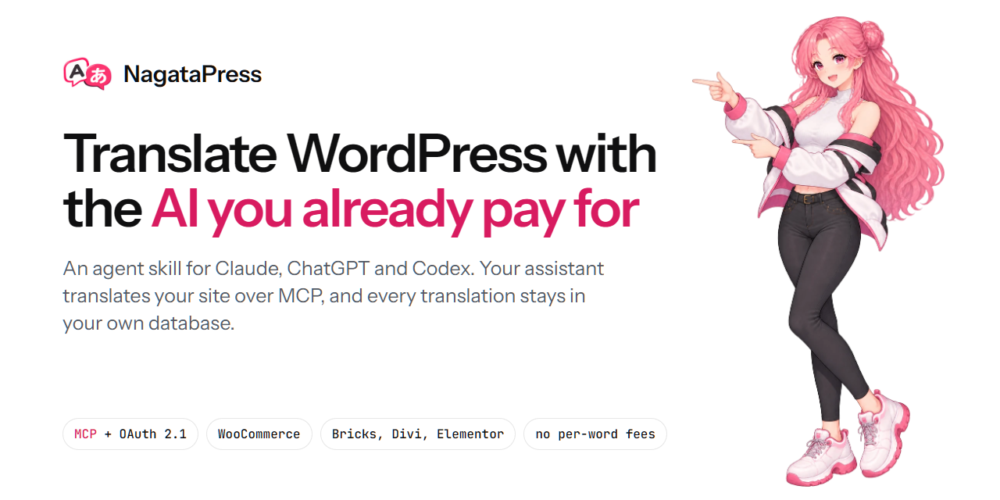
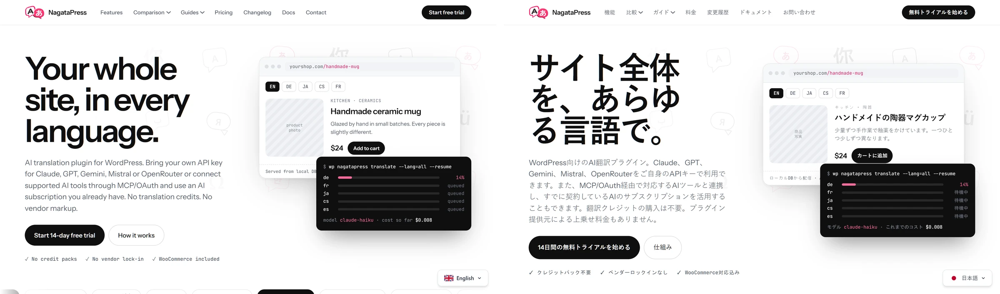
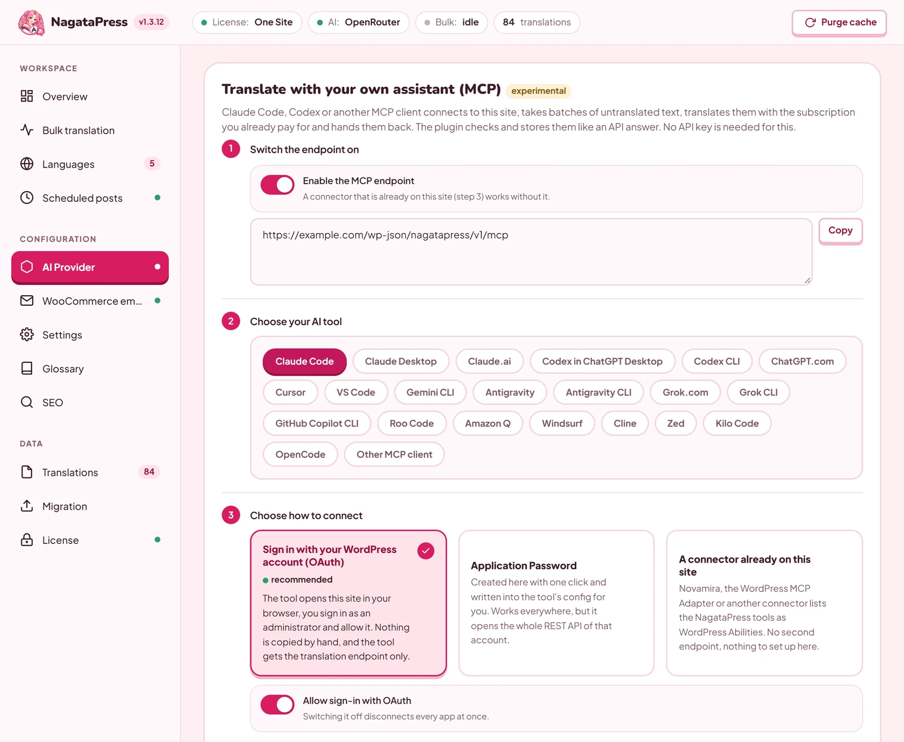
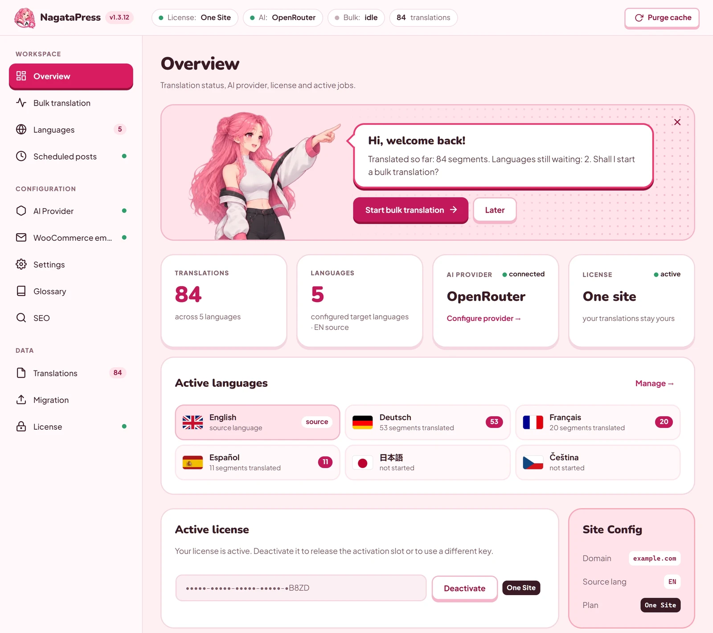
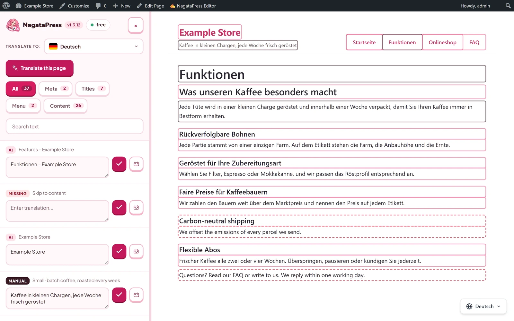
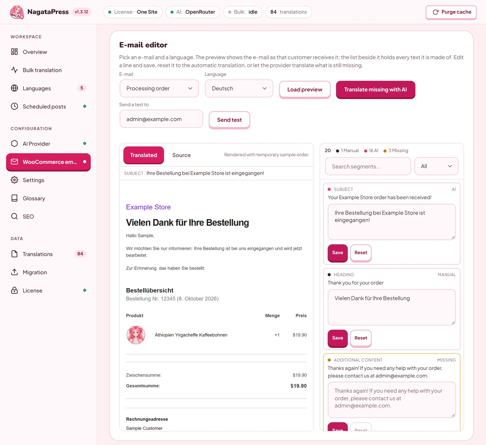

# NagataPress

**English** | [Čeština](README.cs.md)

[](https://github.com/ffscz/NagataPress/releases/latest)
[](LICENSE)
[](https://nagatapress.com)
[](https://nagatapress.com/docs/)



[NagataPress](https://nagatapress.com) is an AI translation plugin for WordPress and WooCommerce. It translates the whole site: posts, pages, menus, page builders, SEO fields and, on a shop, the cart, checkout and customer e-mails. Translations are stored in the site's own database, so a page view never calls an AI. You choose how to translate:

- **With your own API key** (Claude, OpenAI, Gemini, Mistral, OpenRouter). The plugin calls the provider in background runs.
- **With your AI assistant over MCP.** Claude, ChatGPT/Codex, Cursor and other MCP clients connect to your site (OAuth 2.1) and translate within the plan you already pay for. No per-word fees, no credit packs.

**This repository holds the NagataPress skill for AI assistants.** The plugin itself is not published here. It is distributed from [nagatapress.com](https://nagatapress.com/#pricing), with a 14-day free trial.

## See it

nagatapress.com is translated by NagataPress into 13 languages. The same page in English and Japanese:



| Connect your AI tool (MCP) | Overview |
|---|---|
|  |  |
| **Visual editor on the page** | **WooCommerce e-mails** |
|  |  |

## The NagataPress skill


The skill teaches your assistant how to work with NagataPress:

- **Translate a site over MCP.** It runs the batch loop the way the plugin checks it. It keeps every number, price, product name and link marker, uses the right plural form next to a number, and follows the site's glossary and brand context, so fewer translations are rejected.
- **Set NagataPress up with you.** It proposes target languages, Never Translate terms, a glossary, a translation style and the shop's test cart, and changes only what you confirm.
- **Connect your AI tool.** Exact steps for Claude, ChatGPT, Codex, Cursor, VS Code, Gemini CLI and more, plus fixes for failed connections.
- **Answer questions** on setup, licensing, languages, SEO, WooCommerce, WP-CLI, hooks, migration and troubleshooting.

The skill is plain text: Markdown and one small YAML file. It contains no scripts, no keys and no data from any site. It does not connect your assistant to a site by itself. To translate, connect the assistant to your site's MCP endpoint (`https://<your-site>/wp-json/nagatapress/v1/mcp`) first, as [`connect-clients.md`](skills/nagatapress/references/connect-clients.md) explains.

### Install

| Where you use AI | How |
|---|---|
| `npx skills` (Claude Code, Codex, Cursor and others) | `npx skills add ffscz/NagataPress` |
| Claude (claude.ai, desktop app) | Download `nagatapress-skill-<version>.zip` from [Releases](https://github.com/ffscz/NagataPress/releases/latest) (under Assets, not "Source code"), open **Customize > Skills**, click **+**, choose **Upload a skill** and pick the ZIP. Code execution must be on. |
| Claude Code by hand | Copy `skills/nagatapress/` to `~/.claude/skills/nagatapress/` (or `.claude/skills/nagatapress/` in a project). |
| Codex by hand | Copy `skills/nagatapress/` to `~/.agents/skills/nagatapress/` (or `.agents/skills/nagatapress/` in a repository). |
| ChatGPT with Skills (Business, Enterprise, Edu) | **Skills** in your profile menu, add a new skill, **Upload from your computer**, pick the ZIP. |
| Any chat that reads a link | `Read https://nagatapress.com/skill/nagatapress-skill.md and follow it to help me with NagataPress on my WordPress site.` |

### What is inside

```
skills/nagatapress/
├── SKILL.md                      the workflow and the translation rules
├── agents/openai.yaml            display name for Codex and ChatGPT
└── references/
    ├── mcp-translation.md        tools, schemas, tokens, rejection reasons
    ├── connect-clients.md        connecting MCP clients, OAuth details
    ├── setup-and-features.md     install, license, languages, SEO, WooCommerce
    ├── troubleshooting.md        common problems and their fixes
    └── developers.md             WP-CLI, hooks, filters, REST routes, tables
```

### Versions

The skill follows the plugin's version (`plugin-version` in `SKILL.md`). When the site says something different, the assistant trusts the site, because it is the newer source. Each skill version is a `skill-X.Y.Z` tag and a [release](https://github.com/ffscz/NagataPress/releases) with the ZIP and its SHA-256, and the same ZIP is on [nagatapress.com/docs](https://nagatapress.com/docs/#docs-skill).

## Links

- Website and pricing: https://nagatapress.com
- Documentation: https://nagatapress.com/docs/
- Translate WooCommerce with Claude or ChatGPT: https://nagatapress.com/translate-woocommerce-with-claude-chatgpt/
- Security of the MCP endpoint and OAuth: https://nagatapress.com/docs/#docs-17-security
- Changelog: https://nagatapress.com/changelog/

## Repository

Report a mistake in the skill through [Issues](https://github.com/ffscz/NagataPress/issues/new/choose), and ask questions in [Discussions](https://github.com/ffscz/NagataPress/discussions). Please do not report a security vulnerability publicly, but through a [private vulnerability report](https://github.com/ffscz/NagataPress/security/advisories/new), see [SECURITY.md](.github/SECURITY.md). For licensing, billing or help with your site, use the [contact page](https://nagatapress.com/contact/). If you want to suggest a change to the skill, read [CONTRIBUTING.md](.github/CONTRIBUTING.md) first.

## License


The skill and the other files in this repository are licensed under the [Apache License 2.0](LICENSE). The NagataPress plugin is commercial software and is not covered by this license.
